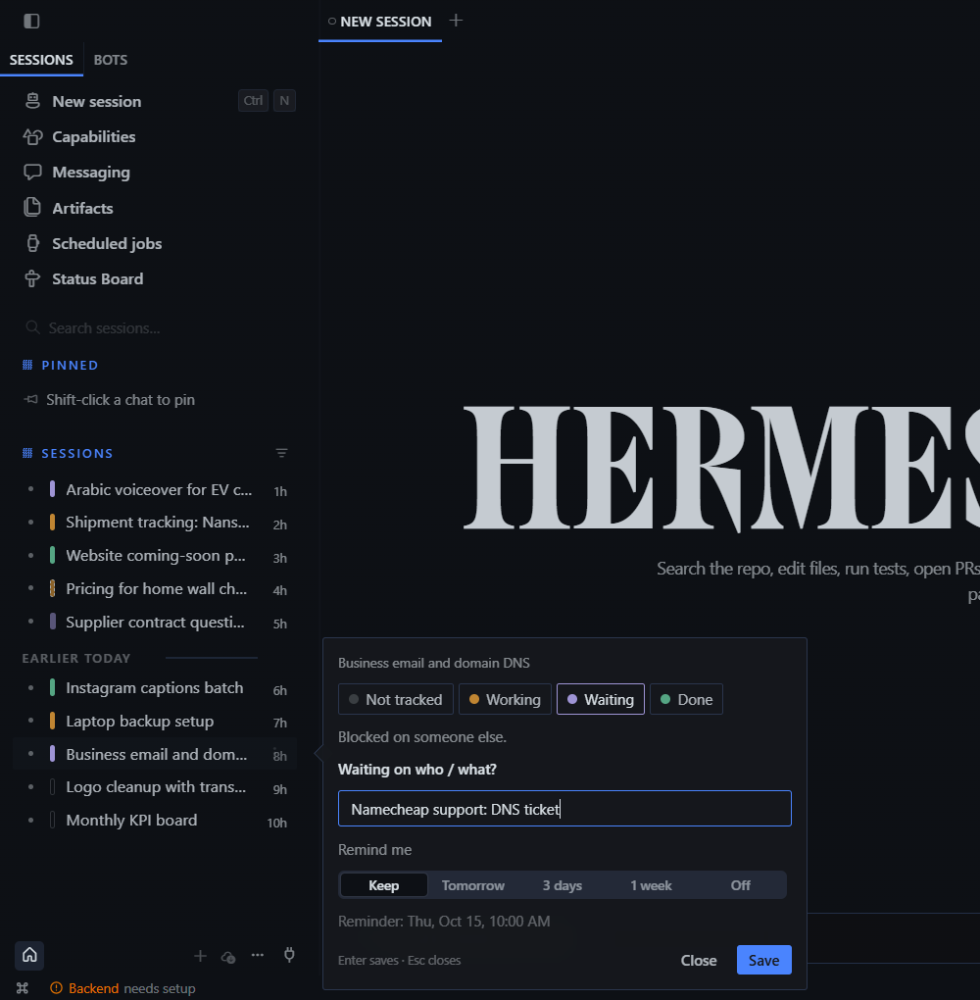

# Waypoint — session status for Hermes Desktop

**Never lose your place again.** Waypoint puts a thin status bar next to every
session in the Hermes sidebar, so you can see at a glance which conversations are
still open, which are stuck on someone else, and which are finished.



## Why

If you work with an AI agent all day, you start ten things, switch projects, and
come back three days later to a sidebar of forty sessions. Which one did you
finish? Which one was waiting on a supplier's documents? Where did you stop?

Waypoint answers those questions with **four states, on purpose**. More colours
means more thinking, so it stays at four:

| Bar | State | What it remembers |
|---|---|---|
| ▯ grey | Not tracked | nothing |
| 🟨 yellow | **Working** | your *next step*: where you stopped |
| 🟪 purple | **Waiting** | *who/what* you're waiting on, plus a follow-up reminder |
| 🟩 green | **Done** | the outcome, and a one-click **fresh start** |

## Features

- **One-click status.** Click the bar to cycle grey → yellow → purple → green.
  Right-click (or Shift+click) opens the status card. Keys **1–4** pick a state,
  **Enter** saves and **Esc** closes.
- **Waiting on someone.** Turning a bar purple asks *"Waiting on who / what?"*
  and *"Remind me: Tomorrow / 3 days / 1 week"*. When the reminder is due you get
  an in-app toast (**Open session** / **Remind tomorrow**) and a native OS
  notification if you're away. The bar also pulses until you deal with it.
- **Resume banner.** Open a Working session and the composer shows *"Where you
  stopped: render the Arabic version"*, with **Insert** to drop it into the
  message box.
- **Fresh start with a handoff.** From a Done session, **Start fresh session**
  opens a new chat already holding a `@session:` link back to the old one, plus
  your outcome and next step. The agent can pull that context without you
  re-explaining anything, and the new session stays short and fast.
- **Status Board** (sidebar → *Status Board*). Shows Working / Waiting / Done
  columns, a *Follow-ups due* strip at the top, stale detection (*untouched for
  9d*), and **Archive N done** in one click. Archived sessions are moved out of
  the sidebar, not deleted.
- **30-second triage.** The board lists recent sessions that have no status yet,
  each with one-click Working / Waiting / Done / Skip buttons.
- **Status bar counter.** `● 3  ● 2!` shows Working, then Waiting (`!` means
  follow-ups are due). Click it to open the board.
- **Morning summary.** Once a day: *"2 working (1 stale) · 3 waiting (1 due)"*.
- **⌘K commands:** mark the current session Working / Waiting / Done, clear its
  status, start fresh, or open the board.
- **Your words.** You can rename the states (e.g. *Doing / Blocked / Shipped*),
  choose the reminder hour, hide grey bars until hover, and set the stale
  threshold.
- **English + Arabic** with full RTL. The card always opens beside the sidebar,
  whichever side the sidebar is on.
- **Backup / restore** your statuses as JSON.

## Privacy

- Everything is stored **locally** in the desktop app's plugin storage, keyed by
  the durable session id, so statuses survive context compression.
- **Nothing is sent to the agent or the model.** The only time session text goes
  near the model is when *you* press **Start fresh session**. That puts a draft
  in a new chat, and you choose whether to send it.
- No network calls and no telemetry. The plugin uses only the official Desktop
  plugin SDK: session-row slots, a route, sidebar nav, status bar, composer
  banner, palette, notifications, and the `session.list` / `session.archive`
  gateway calls.

## Install

**From the Hermes plugin catalog** (once listed):

```bash
hermes plugins install waypoint
```

Then turn it on in **Settings → Plugins → Waypoint**. The desktop half of a catalog
plugin is opt-in, so it stays off until you flip that switch.

**Plugin folder (any Hermes Desktop ≥ 0.21.5):**

1. Unzip `waypoint-<version>-standalone.zip` into
   `<HERMES_HOME>/desktop-plugins/` (usually `~/.hermes/desktop-plugins/`; on
   Windows, `%LOCALAPPDATA%\hermes\desktop-plugins\`). You should end up with
   `desktop-plugins/waypoint/plugin.js`.
2. Hermes Desktop picks it up within a few seconds. If it doesn't appear, run
   **⌘K → Reload desktop plugins**.

**Unified package:** copy the `waypoint/` folder into `<HERMES_HOME>/plugins/`,
then turn it on in **Settings → Plugins**.

## Requirements

Hermes Desktop with the session-row decoration SDK (`SESSION_ROW_AREAS`),
Hermes ≥ 0.21.5.

## Support

Questions or ideas: open an issue on this repository, or email support@dbtechglobal.com.

## License

MIT © 2026 DB TECH. See `LICENSE`.
